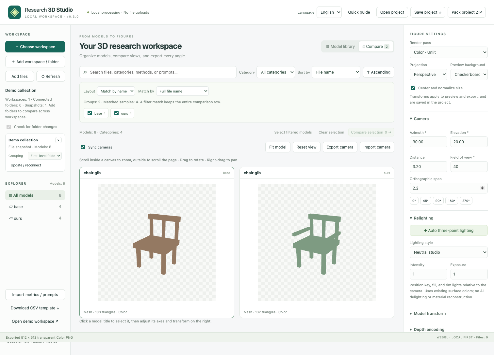

# Research 3D Studio

**English** | [简体中文](README.zh-CN.md)

**[Live demo](https://qiu-yu.top/studio/)**

**A local-first 3D research workspace: browse models, compare synchronized views, relight surfaces, and export independent transparent figures.**



Research 3D Studio turns folders of 3D assets into a sortable gallery and a comparison desk. It runs in your browser, reads local files with your permission, and exports individual images for each model, view, and render pass. No account, dedicated GPU server, or inference backend is required.

## Quick start

Requires **Node.js 22.12+**.

```sh
git clone https://github.com/Qiu-yuChen/research-3d-studio.git
cd research-3d-studio
npm ci
npm run dev
```

Open **http://127.0.0.1:5178/** and choose **Open demo workspace**, select a local folder, or drop model files onto the page. All bundled models and scores are synthetic examples, not research results.

### Static release: no Node.js required

Download `research-3d-studio-v0.3.1-static.zip` from [Releases](https://github.com/Qiu-yuChen/research-3d-studio/releases), extract it, and run this command in the folder containing `index.html`:

```sh
python3 -m http.server 8080 --bind 127.0.0.1
```

Open **http://127.0.0.1:8080/**. All rendering libraries and demo assets are bundled; the downloaded release works offline. Serve it over local HTTP instead of opening the HTML file directly. Press Ctrl+C to stop the server.

### Build and self-host

```sh
npm run build
npm run preview
```

Preview at **http://127.0.0.1:4178/**. The generated `dist/` directory is a complete static application, suitable for GitHub Pages or another HTTPS static host. Relative asset URLs support subdirectory hosting. **Publish only `dist/`; never expose your source checkout, home directory, or dataset folder as the web root.** No API keys or environment configuration are required.

## Features

- **Local workspaces:** recursively discover models, browse folders, search metadata, and sort by name, category, modification time, size, format, score, or paired score difference. Import files, folder snapshots, or drag-and-drop selections.
- **Multiple workspaces and methods:** append folders from different locations, choose grouping depths, match names across methods, and retain missing or ambiguous matches explicitly.
- **Synchronized comparison:** up to four interactive viewports per page, with camera state preserved across pages; shared or independent cameras, perspective or orthographic projection, standard views, camera JSON import/export, and per-model axis/rotation/scale controls.
- **Automatic relighting:** camera-relative key, fill, and rim lights with hemisphere fill. Choose neutral studio, soft fill, or rim emphasis, and adjust intensity and exposure. This uses existing mesh materials; it is not AI delighting or intrinsic material reconstruction.
- **Separate figure exports:** transparent PNGs for color, relighting, clay, camera-space normals, linear depth, and foreground masks. Choose 512–4096 px output, subject to device limits. Each model/view/pass gets its own file.
- **Batch figures:** ZIP archives with independent PNGs, editable SVG contact sheets, and JSON manifests recording cameras, transforms, source hashes, and skipped passes. SVG text and image panels remain individually editable.
- **Reusable projects:** save settings, asset metadata, transformations, cameras, grouping, and selection to JSON. Portable project ZIPs also contain workspace files.
- **Metrics and prompts:** import CSV/JSON metadata, edit model labels and prompts, and sort by Δ = OURS − BASE. The app displays imported metrics; it does not calculate CLIP, ULIP, or other learned scores.
- **English and Simplified Chinese:** English is the first-visit default. The top-bar language switch remembers your choice while preserving workspace, camera, filter, and export state. File names and user-provided text remain unchanged.

Scroll **inside a canvas** to zoom the model; scroll **outside** to move the page. Drag to rotate and right-drag to pan. Preview canvas size does not affect export resolution.

## Folder and workspace comparison

```text
experiment/
  base/       chair.glb  vase.glb  base_only.glb
  ours/       chair.glb  vase.glb  ours_only.glb
  external/   chair.glb
```

Open `experiment` to use its first-level folders as method groups. `chair.glb` becomes a three-method row. `vase.glb` retains an empty external-method cell. Unique or ambiguous files remain in folder sections; when nothing matches, the gallery is organized entirely by folder.

Use **Add workspace / folder** to include other directories. Group each workspace as a whole or by one to three folder levels, and enable individual groups. Workspace identities keep same-name files and their textures separate, including when two roots share the same name.

| Match rule                 | Behavior                                                              |
| -------------------------- | --------------------------------------------------------------------- |
| Full file name (default)   | Case-sensitive, including extension: `chair.glb` matches `chair.glb`. |
| Ignore extension           | Explicitly align files such as `chair.glb` and `chair.obj`.           |
| Relative path within group | Distinguish `chairs/sample.glb` from `tables/sample.glb`.             |

Repeated keys within a group remain conflicts; the app does not silently choose one. Search and category filters preserve a whole matching row when any member matches. Use folder or flat layout for strict per-model filtering. Row sorting follows the first member in the requested sort order, with method columns fixed.

**Compare row** opens every method, with pagination above four models. **Add to export** queues the whole row. Projects retain workspace identities, group depths, enabled groups, matching rules, and comparison selection. JSON projects require reconnecting the corresponding local folders; portable ZIPs restore their bundled files directly. Removing a workspace only removes browser references, not disk files.

## Browser support and refresh

Chrome and Edge support reconnectable directory access on HTTPS or localhost. Folder selection requires a user gesture and requests read permission only. Handles are stored in IndexedDB; the browser may request permission again later. The app rescans connected folders every 15 seconds while in the foreground, when returning to the window, or on manual refresh. This is polling, not an operating-system file watcher.

Browsers without directory-handle support can use file/folder snapshots or drag-and-drop. Reimport a snapshot after changing files. Relative paths identify assets; if individually selected duplicate names cannot express folder structure, import their parent folder instead. Clearing the site's browser data removes saved preferences and handles.

## Formats and rendering

| Input                                       | Available rendering                                                      |
| ------------------------------------------- | ------------------------------------------------------------------------ |
| GLB/glTF, OBJ + MTL/textures, mesh PLY, STL | Mesh color, relighting, clay, normals, depth, mask                       |
| Gaussian PLY, SPLAT, KSPLAT                 | Native Gaussian color; surface passes require an explicitly paired mesh  |
| Point-cloud PLY                             | Color only in this release                                               |
| `.mesh.zip`                                 | Custom mesh bundle containing `scene.json` and geometry/texture payloads |

Keep external glTF buffers and OBJ texture sidecars in the selected workspace. Model-supplied HTTP(S) resources are blocked. Draco/Meshopt-compressed glTF, KTX2 textures, animation timelines, and skeletal editing are not provided in this release; use ordinary GLB/glTF with PNG/JPEG textures.

| Pass    | Convention                                                                              |
| ------- | --------------------------------------------------------------------------------------- |
| Color   | Unlit base color / vertex colors, sRGB output; Gaussians use their own renderer.        |
| Relight | Mesh materials with three-point lighting, ACES tone mapping, sRGB output.               |
| Clay    | Uniform gray mesh material with geometric normals and current lights.                   |
| Normal  | Camera space: +X right, +Y up, +Z toward the viewer; `RGB=(N+1)/2`, no sRGB conversion. |
| Depth   | Linear camera-space Z: `gray=(z-near)/(far-near)`, clipped to the range, 8-bit PNG.     |
| Mask    | White geometric foreground; alpha represents raster coverage.                           |

All exports have transparent backgrounds; checkerboard/white/dark settings affect previews only. Normals, depth, and masks are geometric surface passes and do not model glass transmission or texture transparency. Depth PNG is a lossy visualization, not a floating-point depth file.

By default, models are centered and normalized so the longest bounding-box edge equals one. This can be disabled. Axes and transformations affect the display copy and are recorded in manifests; source files are not rewritten. The app does not infer a semantic front direction. For Gaussians with a paired surface mesh, color remains Gaussian-rendered and other passes use the mesh, with the representation recorded explicitly.

## Metrics and prompts

On initial import, root-level `metrics.csv`, `metrics.json`, `metadata.csv`, or `metadata.json` files are read automatically. You can also use **Import metrics / prompts**. Values keep their original scale.

```csv
path,sample,method,category,prompt,clip,ulip2,surface_path
ours/chair.glb,chair_001,ours,Furniture,A wooden chair,0.32,0.25,
base/chair.glb,chair_001,base,Furniture,A wooden chair,0.28,0.21,
```

JSON accepts the equivalent record array or `{ "assets": [...] }`, with numeric scores optionally nested under `metrics`. `path` is required. Other identity fields are optional; score fields must be finite numbers, empty, or `N/A`.

Δ pairs the two selected methods by `sample`. Each method must have exactly one valid record for that sample. Missing scores and duplicate matches stay missing, and missing values sort last in either direction. The app does not select a best seed, average duplicate matches, or substitute zero.

## Export files and privacy

| File                   | Contents                                                                                                                                                  |
| ---------------------- | --------------------------------------------------------------------------------------------------------------------------------------------------------- |
| `workspace.r3d.json`   | Settings, cameras, asset metadata, and primary model SHA-256 hashes. Reconnect folders on reopen; changed model hashes prevent reapplying old transforms. |
| `workspace.r3d.zip`    | `project.json` plus workspace files under `files/`, for transfer between computers.                                                                       |
| `research-figures.zip` | Individual PNGs in `images/`, editable SVG sheets in `sheets/`, and `manifest.json` with settings and skipped-pass reasons.                               |

The application has no model-upload endpoint, telemetry, or remote inference. A hosting provider can independently add logs or analytics. Local deployments use only the static application and your selected files.

**Exports are not anonymized.** Projects and manifests can contain relative paths, workspace labels, prompts, metrics, hashes, and rendering settings; figure manifests also record the browser user agent. Portable projects contain workspace files. Use dedicated model directories and inspect exported files before sharing. See [SECURITY.md](SECURITY.md) and the [publication review](docs/SECURITY_REVIEW.md).

## Limitations

- Lighting operates on existing mesh surfaces; baked texture shadows are not automatically removed.
- Batch ZIPs are assembled in memory. An estimated pixel-buffer budget above 1 GiB prompts a smaller batch; large scenes and high resolutions remain limited by device memory.
- Comparison displays four viewports per page; batch export is independent of that limit and renders sequentially. SVG sheets contain at most 24 panels each.
- Project restore preserves settings, but does not guarantee identical pixels across browser, GPU, driver, and application versions. Primary-model hashes do not cover every external texture dependency; archive inputs with a portable project when needed.
- Use trusted models and archives. This application is not a comprehensive sandbox for malformed or resource-exhausting inputs.

## Development and validation

```sh
npm run check:publication
npm audit --audit-level=moderate
npm test
npx playwright install chromium
npm run test:e2e
npm run build
npm run check:publication -- --dist
```

Set `PLAYWRIGHT_CHROMIUM_EXECUTABLE` if you need to use an existing Chromium executable. Tests cover data parsing, strict metric pairing, recursive scanning, multi-workspace matching, real WebGL loading, camera synchronization, project restoration, transparent image exports, data-pass encoding, archive contents, and language switching. CI runs the same publication, dependency, test, and build checks. See [validation details and coverage limits](docs/VALIDATION.md).

| Module                             | Responsibility                                             |
| ---------------------------------- | ---------------------------------------------------------- |
| `src/core.js`                      | Data conventions, sorting, Δ, CSV, project validation      |
| `src/workspace.js`                 | Directory access, snapshots, drag-and-drop, stored handles |
| `src/collections.js`               | Workspace identities, grouping, matching, conflicts        |
| `src/models.js`                    | Model loaders and local resource resolution                |
| `src/viewport.js`                  | WebGL, cameras, materials, lights, render passes           |
| `src/export.js`                    | Figure ZIPs, editable SVG sheets, manifests                |
| `src/main.js`                      | Workspace and interface interactions                       |
| `src/i18n.js`, `src/messages.json` | English / Chinese interface                                |

Contributions are welcome. See [CONTRIBUTING.md](CONTRIBUTING.md); include only redistributable fixtures and keep private datasets out of issues and commits.

## License and acknowledgements

Project code and procedural examples use the [MIT license](LICENSE), permitting local deployment, modification, and redistribution with the license notices preserved. Imported models and textures retain their own licenses.

Built with [Three.js](https://github.com/mrdoob/three.js), [GaussianSplats3D](https://github.com/mkkellogg/GaussianSplats3D), and [fflate](https://github.com/101arrowz/fflate). See [THIRD_PARTY_NOTICES.md](THIRD_PARTY_NOTICES.md) and `public/licenses/` for preserved third-party notices.
