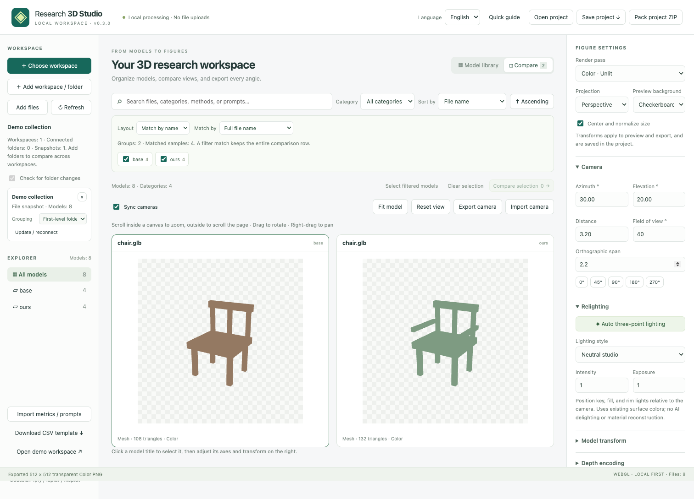

# Research 3D Studio

[English](README.md) | **简体中文**

**[在线演示](https://qiu-yu.top/studio/)**

**本地优先的科研 3D 工作区：浏览模型、同步对照、自动布光，导出每个视角的独立透明图片。**



## 快速开始

允许本地部署，无需账号、专用 GPU 或后端推理服务。需要 Node.js **22.12+**：

```sh
git clone https://github.com/Qiu-yuChen/research-3d-studio.git
cd research-3d-studio
npm ci
npm run dev
```

打开 **http://127.0.0.1:5178/**，点击 **Open demo workspace**，或选择本地工作区／拖入模型。示例模型和指标均为合成数据。

### 无需 Node.js 的静态包

从 [Releases](https://github.com/Qiu-yuChen/research-3d-studio/releases) 下载 `research-3d-studio-v0.3.1-static.zip`，解压后在包含 `index.html` 的目录执行：

```sh
python3 -m http.server 8080 --bind 127.0.0.1
```

打开 **http://127.0.0.1:8080/**。静态包包含全部渲染依赖和示例，下载后可以断网使用。请通过本地 HTTP 服务访问，不要直接双击 HTML；按 Ctrl+C 停止服务。

### 构建与部署

```sh
npm run build
npm run preview
```

预览地址为 **http://127.0.0.1:4178/**。`dist/` 是完整静态网站，可部署到 GitHub Pages 或其他 HTTPS 静态托管服务，支持子目录路径。**只部署 `dist/`，不要把源码目录、个人目录或数据集目录作为公开文件根目录。**

## 语言

默认英语，与浏览器语言无关；右上角 **Language → 中文** 可切换中文并记住选择。切换时保留模型、相机、筛选、分组与导出设置。文件名、prompt 和导入元信息不会被自动翻译。

## 功能

- **工作区**：递归扫描子目录；目录树、分类、搜索；按名称、类别、修改时间、大小、格式、分数或配对差值排序。缩略图逐个生成，列表分批展示。
- **本地导入**：文件夹、文件选择器、文件／目录拖入。OBJ 材质和 glTF 外部资源按工作区相对路径解析。文件内容不上传；不从模型提供的任意网络地址下载纹理。
- **模型格式**：GLB/glTF、OBJ+MTL、网格或点云 PLY、STL；Gaussian PLY、SPLAT、KSPLAT；现有查看器的 `.mesh.zip` 模型包。不同格式的表示能力见下表。
- **对照台**：可加入多个方法，每页最多 4 个同步交互视口，翻页保留相机；独立或共享相机；透视／正交；标准视角、相机 JSON 导入导出；逐模型原生向上轴、旋转、缩放。
- **浏览与操作**：紧凑的方形视口保留两侧留白。画布内普通滚轮缩放模型，画布外滚动页面；拖动旋转、右键平移。预览尺寸不影响导出分辨率。
- **自动 relighting**：按观察方向布置主光、补光和轮廓光，配合环境填充光；中性摄影棚、柔和填充、轮廓强调三种预设；可调光强和曝光。使用已有表面颜色与材质，不做 AI 去光照或内禀材质分解。
- **六个通道**：原色、重光照、灰模、相机空间法线、线性深度、前景 mask。单张透明 PNG，512–4096 px（受浏览器和硬件限制）。
- **论文素材**：选中任意数量模型加入导出队列，指定转台视角和通道；输出 ZIP 内的独立 PNG、透明底且标签可编辑的 SVG 拼图、带相机/变换/源模型 SHA-256 的 JSON 清单。不适用或失败通道单独记录，不生成假图。
- **工程**：JSON 保存模型映射、变换、相机、布光、布局、指标；ZIP 便携工程额外包含工作区文件。浏览器保存最近设置；支持目录句柄的浏览器可以重新连接上次工作区。
- **实验信息**：CSV/JSON 导入指标、prompt、类别、方法、样本 ID；侧栏可编辑样本信息；Δ = OURS − BASE，可按正负过滤。指标只展示和配对，不在浏览器中推理 CLIP/ULIP。

## 工作区与浏览器兼容性

Chrome / Edge 在 HTTPS 或 localhost 下支持目录访问接口。首次选择目录必须由用户发起；只申请读取权限。目录句柄保存在当前浏览器 IndexedDB 中，重新打开可能需要再次授权。前台每 15 秒扫描一次，也支持手动刷新和切回窗口检查；这是重新扫描，不是操作系统级文件监听。

不支持该接口的浏览器提供文件夹选择快照。快照不会自动更新，文件改变后请重新导入。手动选择／拖入文件适用于这些浏览器。清理站点数据会移除设置和保存的目录句柄。

应用源码不包含遥测、上传接口或远程推理。托管服务商可能启用自己的日志或统计，需要独立检查；本地静态包不依赖这些服务。

工作区相对路径作为资产身份。不同文件夹中的同名文件可以共存。单独选择多个同名文件无法表达相对路径时，应用会提示改为导入父文件夹。

## 多文件夹 / 多工作区协同

```text
experiment/
  base/      chair.glb  vase.glb  base_only.glb
  ours/      chair.glb  vase.glb  ours_only.glb
  external/  chair.glb
```

选择 `experiment` 后，默认把一级子目录作为对照组。`chair.glb` 自动排成 base / external / ours 三列；`vase.glb` 对应的 external 单元格留空；只有一个方法拥有的文件保留在下方的文件夹分区。没有匹配项时，整个图库按文件夹分区展示。

点击「追加工作区 / 文件夹」可以连续添加其他位置的目录。每个工作区可选择「整个工作区」或一至三级子目录作为分组；参与比较的组可以独立勾选。目录、模型和纹理保留工作区身份，即使两个目录都叫 base、内部文件也同名，仍会分开保存。重复工作区名称会加序号以便辨认。

- **完整文件名**（默认）：大小写敏感，含扩展名。例如 `chair.glb` 只匹配 `chair.glb`。
- **忽略扩展名**：可显式对齐 `chair.glb` 和 `chair.obj`。
- **组内相对路径**：区分 `chairs/sample.glb` 与 `tables/sample.glb`，适合各方法具有相同子目录结构的情况。

同一组中同一个匹配键出现多次时，该键下的模型全部保留为冲突项，不自动选择任意一条。搜索和类别筛选先找匹配行；命中任一成员时保留整行上下文，也不会用筛选隐藏重复项来消除歧义。需要严格按单个模型筛选时，切换「按文件夹展示」或「平铺全部模型」。修改时间、分数等排序按行内最先命中排序的模型排列，各方法列保持固定。

「对照本行」打开该样本的所有方法，超过 4 个时可翻页；「加入导出」将整行加入批量队列。工程 JSON/ZIP 保存工作区、分组层级、启用组、匹配规则和比较队列，导出清单保留来源工作区和本地相对路径。JSON 本身不包含文件；重开后可通过每个工作区的「更新 / 重新连接」恢复准确的目录映射，尤其适用于多个同名目录。便携 ZIP 可直接恢复全部文件。

刷新会扫描所有已授权的目录，同时保留手动导入和文件快照。某个目录失去权限时保留此前内容并提示；可单独重新连接。移除工作区只移除浏览器中的引用，不删除磁盘文件。

## 指标文件

放在工作区根目录的 `metrics.csv`、`metrics.json`、`metadata.csv`、`metadata.json` 会被初次导入读取；也可点击「导入指标 / Prompt」手动选择。数值保留原量纲，不自动乘 100。

```csv
path,sample,method,category,prompt,clip,ulip2,surface_path
ours/chair.glb,chair_001,ours,Furniture,A wooden chair,0.32,0.25,
base/chair.glb,chair_001,base,Furniture,A wooden chair,0.28,0.21,
```

JSON 可以是相同记录数组，或 `{ "assets": [...] }`。指标可写在 `metrics` 对象中。`path` 必填，其余标识列可选。其他列必须为有限数值、空值或 `N/A`。

Δ 按相同 `sample` 配对两个明确选择的方法；双方各有且仅有一条有效记录才计算。缺失分数、重复配对保持空值，两种排序方向都把空值放在最后。不会选择最好 seed，不平均多条重复，也不补 0。图库中一对模型显示相同的配对 Δ。

## 渲染约定

| 通道   | 定义                                                                       |
| ------ | -------------------------------------------------------------------------- |
| 原色   | 网格 base color / 顶点色，Unlit，sRGB 输出；Gaussian 使用独立 splat 渲染器 |
| 重光照 | 网格材质与三点布光，ACES 色调映射，sRGB 输出                               |
| 灰模   | 统一网格灰色材质，保留几何法线，使用当前灯光                               |
| 法线   | 相机空间，+X 右、+Y 上、+Z 朝观察者；`RGB=(N+1)/2`，无 sRGB 转换           |
| 深度   | 相机空间线性 Z，`gray=(z-near)/(far-near)`，8-bit PNG 灰度；区间外截断     |
| Mask   | 几何前景为白色，alpha 为栅格覆盖度                                         |

所有导出背景透明。棋盘、白色、深色设置只影响预览。法线、深度、mask 是几何表面通道，不模拟玻璃透射或纹理透明度；PNG 深度是有损可视化，不是原始浮点深度文件。

默认将模型包围盒中心移至原点，并把最大边长归一到 1；可以关闭。附加轴向与旋转作用在显示副本，不写回源文件。归一化、模型变换和相机均进入导出清单。不同物体的语义正面不会自动猜测。

纯 Gaussian 和无网格点云没有本工具所需的表面材质。Gaussian 可在「模型姿态」中选择配对表面网格；原色仍使用 Gaussian，其余通道使用配对网格，并在清单里标记。应用不会把调亮 Gaussian 当作物理 relighting。无网格点云首版仅提供原色。

## 工程与素材

- `workspace.r3d.json`：设置、相机、资产元信息、主模型文件 SHA-256。恢复时重新连接相同工作区；主模型哈希改变则不套用该记录的旧变换。
- `workspace.r3d.zip`：`project.json` 加 `files/` 内工作区文件，可跨电脑打开。
- `research-figures.zip`：`images/` 独立 PNG、`sheets/` SVG 拼图、`manifest.json` 完整导出参数与跳过原因。
- SVG 保留单独的图片元素和文字元素，可继续调整标签、间距和位置；每张拼图最多 24 个面板。

工程恢复提供可复用设置，并不保证不同浏览器、GPU、驱动和版本的逐像素一致。主模型哈希不覆盖所有外部纹理依赖；需要封存所有输入时请使用便携工程 ZIP。

## 当前限制

- glTF 的 Draco / Meshopt 压缩、KTX2、动画时间轴、骨骼编辑未作为本版本功能提供；请先导出普通 GLB/glTF。普通 PNG/JPEG 纹理已验证。
- 自动布光处理已有网格表面。烘焙在贴图里的阴影不会自动去除；不宣称真实材质恢复。
- 批量 ZIP 在内存中打包。像素缓冲预算超过 1 GiB 时提示减小批次；大型模型、Gaussian 场景和高分辨率仍受设备内存限制。
- 每页同步交互视口最多 4 个，可翻页查看其余方法；批量队列独立于视口数，顺序渲染。
- 工程 ZIP 包含导入工作区中的文件。请选择与该工程有关的目录。

## 验证与开发

```sh
npm run check:publication
npm audit --audit-level=moderate
npm test
npx playwright install chromium
npm run test:e2e
npm run build
```

如果已有 Chromium，可通过 `PLAYWRIGHT_CHROMIUM_EXECUTABLE` 指定其可执行文件。测试覆盖路径解析、CSV、空值与配对、目录递归、真实浏览器加载、相机同步、工程恢复、透明 PNG、数据通道编码和 ZIP 内容。

```text
src/core.js       数据约定、排序、Δ、CSV 和工程校验
src/workspace.js  目录 / 拖入 / 文件快照 / IndexedDB 句柄
src/collections.js  多工作区身份、对照分组、同名匹配与冲突判定
src/models.js     通用模型、纹理和相对路径解析
src/viewport.js   WebGL、相机、材质、布光、导出通道
src/export.js     素材 ZIP、SVG 拼图、参数清单
src/main.js       工作区和界面交互
src/i18n.js       语言选择、文案插值和页面翻译
src/messages.json  英语 / 中文文案
```

公开示例与指标均为合成数据，不代表实验结果。项目不需要服务器地址、API 密钥或环境配置文件。

## 隐私与安全

文件在浏览器中读取和渲染。目录连接只申请读取权限；目录句柄保存在 IndexedDB，偏好与工程元信息保存在当前站点的浏览器本地存储中。清理站点数据可移除这些保存内容。

**导出不会自动匿名化。** 工程 JSON 和素材清单可能含相对路径、工作区名称、prompt、指标、文件哈希与渲染参数，素材清单还包含浏览器 user agent。便携工程 ZIP 包含工作区文件。请使用独立的模型目录，并在分享导出内容前检查其中的数据。

发布检查会扫描常见凭据、内网 IP、个人绝对路径、截图文本元数据和异常文件路径。它不是完整的渗透测试；超大或恶意模型／压缩包仍可能耗尽浏览器内存。见 [安全说明](SECURITY.md) 和 [发布检查记录](docs/SECURITY_REVIEW.md)。

## 许可证与贡献

项目代码和自制示例采用 [MIT 许可证](LICENSE)，允许本地部署、修改和再分发；请保留许可证与第三方声明。导入模型和纹理仍遵循各自许可证。

渲染与打包基于 [Three.js](https://github.com/mrdoob/three.js)、[GaussianSplats3D](https://github.com/mkkellogg/GaussianSplats3D) 和 [fflate](https://github.com/101arrowz/fflate)。完整声明见 [THIRD_PARTY_NOTICES.md](THIRD_PARTY_NOTICES.md)。开发贡献请参阅 [CONTRIBUTING.md](CONTRIBUTING.md)，验证范围见 [docs/VALIDATION.md](docs/VALIDATION.md)。
