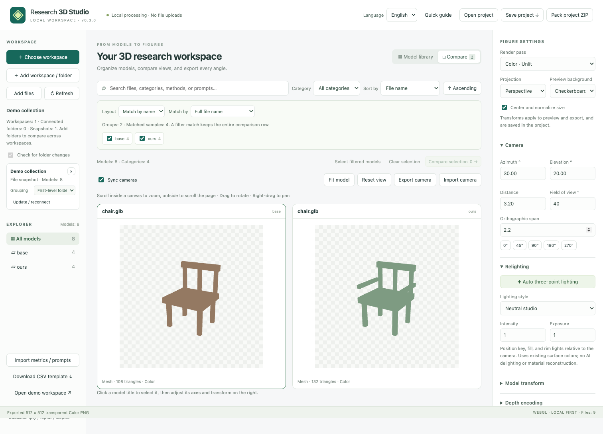
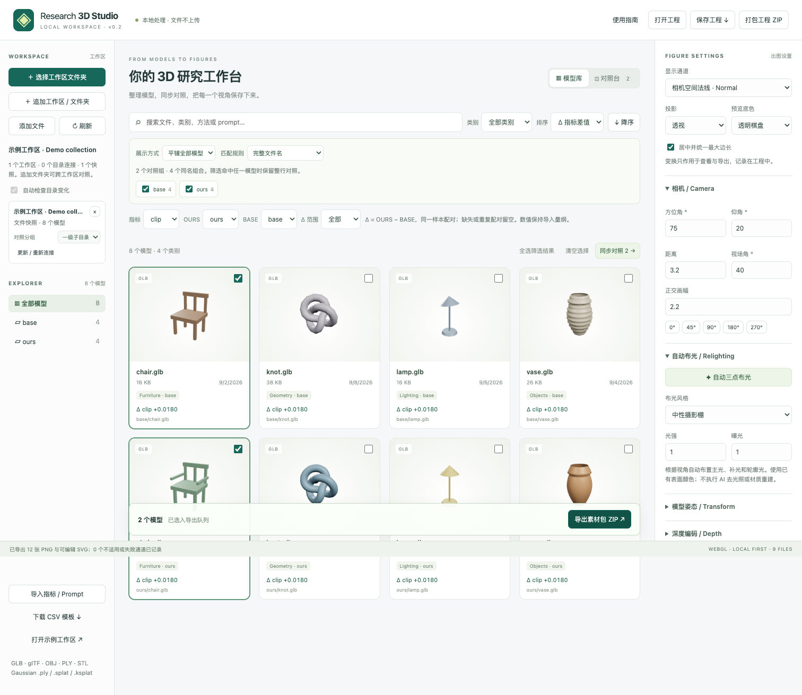

# Validation

## v0.3.1 public release

Verified on 2026-09-21 with Node.js 24.14.0 and Chromium on macOS. All 15 unit tests and 13 browser tests passed (the 11 existing workflows plus two security tests). The production build and source/build publication checks passed; `npm audit` reported no known vulnerabilities after upgrading fflate to 0.8.3. See [the publication review](SECURITY_REVIEW.md) for scope, findings, and limits.

Local browser checks used an existing Chromium installation via `PLAYWRIGHT_CHROMIUM_EXECUTABLE`; the initial default-browser launch failed because that Playwright browser binary was not installed. CI installs its required Chromium version explicitly.

## v0.3.0 English / Chinese interface and local deployment

Verified on 2026-09-21 with Node.js 24.14.0 and Chromium on macOS.

- 13 unit tests passed, including translation coverage, matching interpolation fields, English defaults, language fallback, localized validation errors, and literal preservation of user data.
- 11 browser tests passed: all eight existing workflows plus three language tests. English is the first-visit default, even in a Chinese browser; Chinese and English selections survive reloads. Switching with preference storage blocked still works for the current page.
- Language switching preserves the actual canvas elements and the exported assets, camera records, settings, selection, grouping and comparison pagination. User-supplied Chinese file names and prompts remain unchanged. Existing errors and status messages switch languages without rerunning the operation.
- English layouts were checked at 1512, 1100, 850 and 390 px widths; narrow layouts had no horizontal page overflow. English desktop and mobile screenshots were visually inspected.
- A production build served by Python's local HTTP server was tested with all non-local network requests blocked. Mesh and Gaussian models loaded, both languages worked, a saved language survived reload, and a 512 × 512 PNG contained both foreground and transparent pixels. There were no page errors and no external requests.
- The ready-to-run static archive includes its rendering libraries, demo assets, license notices and bilingual local deployment instructions. The source archive includes both language catalogs and tests.

## v0.2.1 compact comparison update

Verified on 2026-09-21. Comparison canvases are capped at 360 px (440 px for a single model), with at least 20 px of horizontal space on each side. The OrbitControls implementation and export code are unchanged.

- Browser smoke check at 1512 × 900: a 360 × 360 canvas in a 474 px card left 57 px on each side. A wheel event in the margin scrolled the page 220 px without changing camera distance; a wheel event inside the canvas changed camera distance from 3.20 to 3.47 without scrolling the page. Dragging still rotated the model. No page errors occurred.
- The existing gallery, synchronized camera, relighting, project restore and figure ZIP browser test passed, including transparent PNG dimensions and exported camera records.
- The comparison screenshot was visually inspected. Build and deployment checks are recorded in the release artifacts.

## v0.2.0 baseline

Verified on 2026-09-21 with Node.js 24.14.0, Vite 7.3.6, Three.js 0.160.1 and a Chromium browser on macOS.

## Automated checks

- `npm test`: 10 tests passed. Path normalization, CSV quoting, strict sample/method pairing, missing values, sorting, project validation, recursive directory scanning and sidecar preservation.
- `npm run test:e2e`: 8 tests passed using actual WebGL rendering. Includes the eight-model demo, external OBJ/MTL/texture loading, mesh and point-cloud PLY, STL, Gaussian SPLAT, and glTF with an external binary buffer.
- Synchronized cameras and camera JSON, project JSON restoration, portable project ZIP restoration, manual file selection and browser drag/drop were exercised.
- A batch with two models, two views and three passes produced 12 separate PNGs. ZIP contents, transparent alpha, editable SVG layout and manifest records were checked.
- Normal encoding on a front-facing plane was checked against RGB approximately `(128, 128, 255)`. Linear depth was checked numerically against the configured camera distance and clipping planes. Foreground mask was checked against white RGBA.
- The relighting output differs from unlit color. OBJ texture pixels were verified after the image completed loading, rather than only checking whether a mesh appeared.
- `npm run build`: passed. The generated static bundle includes runtime dependencies and demonstration assets.

## Multi-workspace checks

- Three method folders produce stable same-name columns; incomplete matches retain an empty cell and unique files remain grouped by folder.
- Five independent workspaces, including two roots named `base`, preserve all same-name models and texture sidecars. All five methods are accessible through viewport paging, with a checked camera position across pages.
- Full-filename, extension-independent and group-relative matching are covered. Duplicate keys remain conflicts; changing a grouping depth changes the group boundaries explicitly.
- Portable ZIP restores all five sources; OBJ textures are pixel-checked again after restoration. Disabled groups and display mode also survive project export/import.
- JSON project reconnection restores source mappings individually, in a different order. Updating one snapshot preserves the other workspace. Relative metric paths are resolved within their source.
- A simulated directory handle exercises scanning after additions and deletions while preserving an appended file snapshot. This tests application scanning behavior, not an OS permission dialog.

## Visual inspection

The gallery and comparison screenshots were inspected for rendered models, labels, controls and layout. The demo also rendered successfully inside the desktop application's embedded browser.

## Coverage boundaries

The native directory-picker permission prompt and reconnection prompt require a real user gesture. Recursive directory-handle scanning is unit-tested; folder snapshot import is browser-tested. This is not a claim that native permission prompts were automated across every browser or OS.

Draco/Meshopt/KTX2 compressed glTF, very large scenes, every third-party model exporter, Gaussian PLY/KSPLAT variants and `.mesh.zip` variants do not have exhaustive browser fixtures in this initial release. Unsupported surface passes are reported explicitly. Depth PNG is an 8-bit visualization, not floating-point scientific depth.

The procedural examples and their synthetic metrics demonstrate the interface only; they are not experiment results or a rendering-quality benchmark. No private research models are bundled.

## Hosted smoke check

The HTTPS deployment loaded two workspaces with 12 models and four three-method matching rows. Three synchronized viewports rendered, a 512 px transparent relit PNG downloaded successfully, and the source archive checksum matched. No application upload requests were observed. The hosting layer injected one Cloudflare RUM performance beacon; this is separate from the application source and local model processing.
